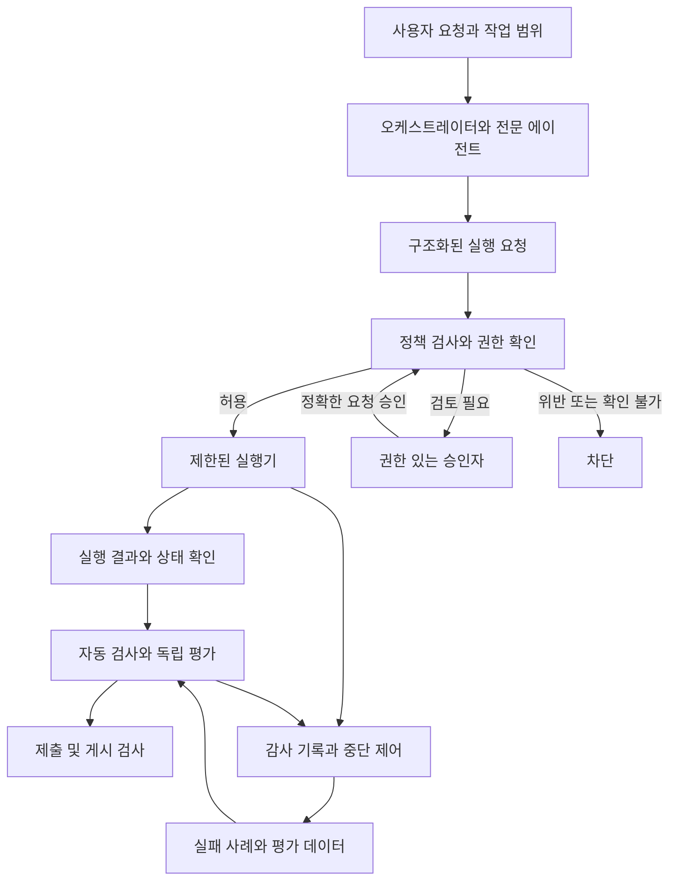

# 에이전트 실행 통제와 지속 검증 설계

## 1. 기본 정보

기존 `orchestrator`, 전문 에이전트, `evaluator`, 정책·지식·스킬 관리 역할을 유지하고, 실제 실행 경계와 검증 경로를 보강한다. 이 문서는 구현 설계이며, 안전 기능이 이미 설치되거나 운영 환경에 적용됐다는 의미는 아니다.

- 작업: `ax-controls-design`
- 범위: `multi / agent-framework / development / execution-control-continuous-validation-design`
- 작성일: 2026년 10월 28일, 한국 시간
- 결과 계약: 현재 `result.schema.json` 1.0.0 유지
- 상세 구현 계약: [영어 구현 명세](implementation-spec.en.md), [정책 명세](risk-policy.en.md)

현재 저장소의 제출 검사는 결과 형식, 증거 파일, 해시를 확인한다. 도구 실행 경계나 운영 자격증명을 통제하는 실행기는 포함하지 않는다. 이번 설계는 이 차이를 유지하면서 도입 순서와 통과 조건을 정한다.

## 2. 목표 및 완료 기준

목표는 잘못된 AI 판단이 실제 변경으로 이어지기 전에 검사하고, 변경 후 결과를 확인하며, 발견한 실패를 다음 검증에 반영하는 것이다.

설계의 완료 조건은 다음과 같다.

1. 실행 요청부터 정책 판단, 필요한 승인, 실행 결과, 평가 증거까지 연결할 수 있는 데이터 계약을 정의한다.
2. 개발 단계에서 가능한 검사와 격리된 실행기가 있어야 보장할 수 있는 통제를 구분한다.
3. 위험도별 자동 허용·차단·검토 조건과 오류·시간 초과·중단·재시도 규칙을 정한다.
4. 평가 사례, 자동 실행 시점, 차단 기준, 운영 감시와 사고 처리 절차를 정의한다.
5. 기존 파일과 계약의 호환성, 구현 순서, 검증 방법, 미결정 항목을 기록한다.

실제 기능 구현, 운영 환경 연결, 규제 준수 인증은 후속 작업이다. 설계 완료 여부와 기능 배포 여부는 별도로 기록한다.

## 3. 결과 요약

### 실행 경로

운영 자격증명은 실행기만 보유한다. 에이전트가 직접 운영 도구·네트워크·자격증명에 접근할 수 있다면 위 경로를 우회할 수 있으므로, 정책 검사 CLI를 추가한 것만으로 운영 보안 경계가 완성됐다고 판단하지 않는다.

### 구성 요소

| 구성 요소 | 책임 | 신뢰 경계 |
|---|---|---|
| 실행 요청 계약 | 대상·환경·행동·예상 변경·사전 상태를 고정 | 모델이 작성한 입력은 신뢰하지 않고 검사 |
| 정책 검사기 | 허용 목록, 범위, 위험도, 권한, 한도를 확인 | 에이전트가 검사를 생략하거나 정책을 스스로 활성화할 수 없도록 배치 |
| 승인 기록 | 필요한 경우 정확한 행동에 대한 승인과 유효기간을 연결 | 요청자와 승인 권한을 분리 |
| 제한된 실행기 | 검증된 요청만 정해진 어댑터로 실행 | 별도 실행 계정, 제한된 네트워크, 자격증명 보관 |
| 검증 실행기 | 승인된 테스트와 기대 결과를 별도 저장소에서 선택하고 실제 동작을 관찰하여 증거 발급 | 작업 작성자가 테스트·기대 결과·검사기를 수정하거나 가짜 보고서로 통과를 만들지 못하게 구성 |
| 독립 평가자 | 요구사항, 근거, 누락과 위험을 평가 | 실행 신원과 검토 대상 버전을 검증 |
| 감사·감시 | 민감정보를 제거한 결정·실행·결과 기록, 이상 시 중단 | 에이전트가 원본 기록과 신뢰 키를 수정하지 못하도록 구성 |

## 4. 수행 내용

### 기존 역할의 책임

| 기존 역할 | 추가되는 책임 |
|---|---|
| orchestrator | 작업 범위와 완료 기준 확정, 실행 요청 조정, 오류·중단 상태 통합 |
| coding / infrastructure / oss-rnd | 구조화된 행동 제안, 검증 가능한 예상 결과와 복구 계획 제공 |
| evaluator | 증거·대상 버전·작성자 분리 확인, 의미적 품질 검토 |
| policy-manager | 정책 변경안과 규정별 통제표 유지. 정책 활성화 권한은 별도 담당자에게 부여 |
| knowledge-manager | 비밀정보를 제거한 실패 사례, 출처, 적용 범위 관리 |
| skill-manager | 스킬·도구 변경의 영향과 재검증 대상 관리 |
| 인간 운영 책임자 | 고위험 실행, 예외, 잔여 위험, 운영 중단·재개 결정 |

역할 이름이나 Markdown의 `scope`는 OS 접근 권한을 만들지 않는다. 실제 권한은 호스트·실행기·자격증명 시스템에서 제한한다.

### 위험별 처리

| 사례 | 기본 처리 |
|---|---|
| 허가된 작업 범위의 로컬 파일 조회와 분석 | 기존 권한으로 자동 처리 |
| 허가된 개발 작업의 되돌릴 수 있는 파일 변경·테스트 | 범위·경로·한도 검사 후 자동 처리 |
| 현재 작업 소유 파일의 지정 원격·브랜치 게시 | 기존 상시 승인을 재사용하고 목적지·소유권·검증 결과를 확인 |
| 운영 설정 변경, 권한 변경, 민감 데이터 전송 | 허용된 실행 유형인지 먼저 확인하고 필요 시 정확한 변경안에 대한 승인 요구 |
| 자격증명 탈취, 무단 외부 전송, 통제 우회 | 차단하고 사건으로 기록 |
| 대상·권한·정책 유효성을 확인할 수 없음 | 실행하지 않고 확인 가능한 상태로 전환 |

정책이 허용하지 않는 행동은 승인 버튼만으로 허용하지 않는다. 승인받은 요청의 대상·인자·변경 내용이 달라지면 기존 승인을 재사용할 수 없다. 이미 허용된 저위험 작업에 매번 추가 승인을 요구하지 않는다.

### 단계별 구현 순서

| 단계 | 구현 범위 | 종료 조건 | 보장 수준 |
|---|---|---|---|
| P0 | 계약, 정책 판정, 실행하지 않는 관찰 모드, 합성 평가 사례 | 계약과 판정 사례 검증, 허용·차단 이유 추적 가능 | 판단 기록. 보호 대상 실행 허용 없음 |
| P1 | 개발 작업용 어댑터, 신뢰 가능한 테스트 증거, 제출·게시 검사, 변경 시 CI | 정상·오류·위조·재사용 사례 통과, 기존 결과 계약과 회귀 호환 | 개발 검증과 제출 경로 통제. 직접 셸 우회 방지는 아직 별도 조건 |
| P2 | 격리된 실행기, 운영 자격증명 분리, 네트워크 제한, 중단·복구 | 직접 접근·우회 시도 차단과 중단 경합 검증 | 승인된 보호 대상의 제한적 시범 운영 가능 |
| P3 | 운영 지표·경보·평가 보정, 사고 절차, 준수 요건 관리 | 담당자·대응 절차·보존 정책 확정, 시범 운영 지표 충족 | 검증된 업무 범위 내 단계적 확대 |

P2의 격리 조건을 충족하기 전에는 운영 변경 어댑터를 활성화하지 않는다. 현재 호스트에 필요한 연결 기능이 없으면 해당 기능은 미지원으로 표시하며, 같은 권한의 래퍼를 보안 격리로 설명하지 않는다.

게시 검사에도 같은 원칙을 적용한다. P1에서 최신 CLI가 증거를 검사하더라도 에이전트가 기존 CLI나 직접 `git push`를 사용할 권한이 있으면 우회할 수 있다. 우회 불가능한 게시 보장을 주장하려면 원격 저장소·릴리스 서비스의 별도 필수 검사 또는 에이전트의 직접 게시 자격증명 제거가 필요하다. 기존 상시 승인은 유지하되 실제 게시 권한은 이 경계에서 집행한다.

### 지속 검증

평가는 세 시점에 실행한다.

- **변경 시:** 모델·프롬프트·스킬·정책·도구·스키마·평가 데이터 변경에 대해 관련 평가와 필수 보안 회귀를 실행한다.
- **실행 시:** 대상과 권한을 확인하고, 실행 직전 사전 상태를 다시 확인하며, 실행 후 실제 결과를 검사한다.
- **운영 중:** 실패율·차단·승인·증거 누락·중단·비정상 반복을 관찰하고 새 실패 사례를 평가 데이터에 반영한다.

잘못된 환경 변경, 승인 내용 변조, 비밀정보 유출, 증거 위조와 같은 필수 금지 사례는 허용 건수 0을 통과 기준으로 삼는다. 이것은 준비된 사례에서의 기준이며 실제 오류 확률이 0이라는 의미가 아니다. 업무 정확도와 성능 기준은 대표 데이터로 측정하고 운영 책임자가 정한다.

운영 사건은 신규 실행 차단, 진행 중 작업의 상태 확인, 영향 범위 기록, 복구 계획 검토, 관련 평가 재실행, 권한 있는 담당자의 재개 결정 순서로 처리한다. 이미 발생한 변경은 자동으로 되돌릴 수 있다고 가정하지 않는다.

필수 테스트와 기대 결과는 담당자가 승인한 저장소·버전에서 검증 서비스가 선택한다. 검증 대상 코드는 별도 자식 샌드박스에서 실행하고, 필수 검사기와 기대 결과에는 쓰기 권한을 주지 않는다. 대상 코드가 출력한 성공 메시지·JUnit 파일·종료 코드만으로 필수 검증을 통과시키지 않는다. AI가 제안한 새 테스트는 독립 검토 후 평가셋에 편입한다.

## 5. 산출물

- [구현 명세](implementation-spec.en.md): 파일·함수 연결점, 상태 전이, 인터페이스, 단계별 구현 작업과 검증 사례.
- [위험 정책 명세](risk-policy.en.md): 신뢰 경계, 위험별 판정, 승인·차단·중단·복구·운영 기준.
- [JSON Schema 초안](contracts.schema.json): 후속 구현용 계약. 현재 활성 스키마가 아님.
- [계약 예제](examples.json): 합성 입력과 출력. 실제 승인이나 서명된 실행 증거가 아님.
- [통제 추적표](control-matrix.json): 위협, 통제, 책임, 증거, 검증, 도입 단계의 연결.
- 작업 명세: `.agent-work/tasks/ax-controls-design/spec.md`; 상세 설계 파일은 해당 `record.json`의 산출물 목록으로 연결된다.

구조와 검증 방향의 근거:

- [Microsoft 에이전트 설계 패턴](https://learn.microsoft.com/en-us/azure/architecture/ai-ml/guide/ai-agent-design-patterns): 기존 관리자·전문가 구조를 비교할 수 있는 사례.
- [OpenAI 실행 통제](https://developers.openai.com/api/docs/guides/agents/guardrails-approvals): 부작용이 발생하는 도구 경계에서의 검사와 승인.
- [OpenAI 지속 평가](https://developers.openai.com/api/docs/guides/evaluation-best-practices): 변경 시 평가, 운영 사례 축적, 사람의 평가와 보정.
- [NIST AI RMF](https://nvlpubs.nist.gov/nistpubs/ai/nist.ai.100-1.pdf): 책임, 위험 파악, 측정, 대응의 관리체계. 법규 준수 인증을 대신하지 않는다.

## 6. 검증 결과

이번 설계의 검증 결과와 증거는 자동 생성되는 `result.json`과 `result.md`에 기록한다. 계약 예제의 구조 검사는 실제 정책 엔진·실행기·서명 검증의 동작 시험과 구분한다.

후속 구현에서 필수로 검증할 항목은 다음과 같다.

| 검증 영역 | 최소 기대 결과 |
|---|---|
| 정상적인 허가 작업 | 불필요한 승인 없이 허용, 결과와 증거 연결 |
| 다른 환경·프로젝트·대상 | 범위 불일치로 차단 |
| 승인 후 인자·정책·대상 상태 변경 | 기존 승인 사용 불가 또는 재검토 |
| 만료·중복 요청·시간 초과 | 재사용 차단, 변경 결과 불명 시 무조건 재실행하지 않음 |
| 외부 문서의 악성 지시 | 실행 권한·정책 변경으로 승격되지 않음 |
| 작성자가 만든 허위 통과 증거 | 신뢰할 수 있는 실행 증거 없이는 보호된 제출 불가 |
| 직접 셸·네트워크 우회 | 격리 단계에서 실제 접근 거부 |
| 중단 신호와 진행 중 실행 | 신규 실행 차단, 이미 실행된 결과는 별도로 확인 |
| 비밀정보·개인정보 | 감사 저장 전에 제거, 보호 대상 전송은 정책 검사 |
| 기존 작업·스냅샷 | 변경하지 않음. 현재 신뢰 수준을 과거 작업에 소급 부여하지 않음 |

## 7. 미해결 사항 및 다음 조치

설계 후 바로 착수할 작업은 P0 계약·판정기·합성 평가셋 구현이다. 다음 작업은 새 범위에 묶고 이 설계의 커밋과 해시를 입력으로 고정한다. 현재 작업의 스냅샷이나 제출 결과는 수정하지 않는다.

보호 대상 시범 운영 전에 다음 항목을 확정해야 한다.

| 결정 | 확정 전 처리 |
|---|---|
| 첫 대상 업무와 시스템, 운영·개발 환경 | 합성 데이터와 개발 샌드박스에서만 검증 |
| 실행기 호스트와 계정·네트워크 격리 방식 | 보호 대상 어댑터 비활성화 |
| 승인자·정책 관리자·감사 관리자·사고 책임자 | 보호된 고위험 실행 차단 |
| 자격증명 저장소·서명 키와 교체·폐기 방식 | 실제 운영 자격증명과 신뢰 서명 사용 금지 |
| 적용 규정·계약·데이터 등급·보존기간 | 규제 준수 상태를 미확인으로 유지 |
| 실제 업무 평가셋과 통과 임계치 | 운영 확대 금지, 대표 사례 수집·보정 |

이 항목은 설계 저장을 막지 않는다. 후속 단계의 활성화 조건이며, 미확정 상태를 임의의 운영 기본값으로 대체하지 않는다.
