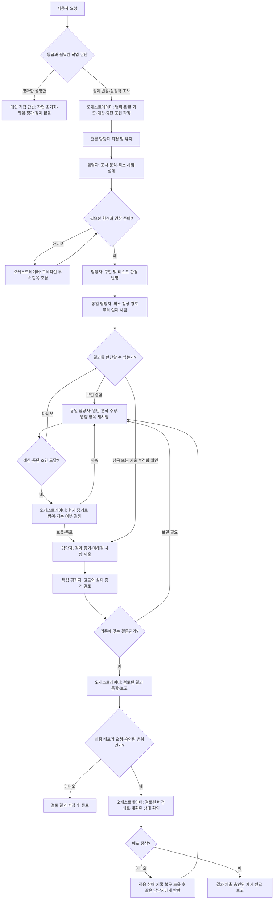

# 담당자 책임형 작업 파이프라인

이 문서는 `shared/workflows/owner-led-delivery.md` 1.4.0의 한국어 안내입니다. `AGENTS.md`가 메인 세션과 모든 위임 역할에 공유 워크플로우를 읽고 따르도록 연결합니다. 호스트 권한을 강제하는 실행 코드나 자동 실행 엔진을 새로 만든 것은 아닙니다.

## 역할과 책임

| 담당 | 책임 |
|---|---|
| 오케스트레이터 | 목적·범위·완료 기준·작업 예산·담당자 지정, 필요한 권한·외부 결정 조율, 검토된 결과 통합과 승인된 최종 배포 |
| 동일 전문 담당자 | 분석, 구현, 테스트 환경 반영, 실제 시험, 실패 원인 분석, 수정과 영향 범위 재시험 |
| 독립 평가자 | 정확한 후보 버전과 실제 시험 증거 검토, 필요한 항목만 독립 재현, 결함을 같은 담당자에게 반환 |
| 사용자 | 필요한 요구사항·외부 결정 제공, 기존 승인에 포함되지 않은 도입·배포 결정 |

인프라 도입 R&D는 인프라 담당자가 PoC와 환경 시험을 책임지고, OSS R&D 담당자가 공식 자료·대안·라이선스 조사 등의 한정된 부분을 맡을 수 있습니다. 버그가 생길 때마다 담당자를 바꾸지 않습니다.

## 작업 등급과 직접 답변

메인은 영향·불확실성·복구 가능성으로 등급을 정합니다. 실제 변경은 기존 작업 기록에 등급과 이유를 한 줄 남기며, 파일 수나 줄 수만으로 판단하지 않습니다.

| 등급 | 대상 | 기본 처리 |
|---|---|---|
| 경량 | 명확한 설명, 제품 동작·권한·보안 경계에 영향 없는 문구·링크·작은 설정 정리 | 설명은 메인 직접 답변. 실제 변경은 담당자 1명과 다른 작성자의 좁은 독립 적대적 검수, 짧은 영속 기록 |
| 일반 | 통상 기능·버그·API·의존성·동작 변경과 실질적인 조사·설계 | 짧은 계획, 필요한 조사만 수행, 같은 담당자의 구현·관련 시험, 독립 검수와 영향 범위 수정·재검수 |
| 고위험 | 인증·자격증명·권한·OS 격리·실행 및 게시 게이트, 운영 배포·영향 큰 외부 쓰기, 삭제·마이그레이션·복구 | 영향·복구 계획, 필요한 전문 조사와 핵심 실환경 검증, 독립 검수, 기존 승인·필수 게이트·적용 후 확인 |

설정 파일도 namespace·서비스 권한·검수 의무·게시 게이트에 영향을 주면 일반 또는 고위험입니다. 위험을 가리는 불확실성을 먼저 좁게 조사하고, 고위험 조건이 해소되지 않으면 고위험으로 다룹니다. 같은 보안 경계를 쪼개 경량으로 우회하지 않습니다. 경량 작업에 조사·설계·관리 역할을 자동 추가하지 않고, 결과가 계획을 바꾸지 않았다면 재계획 호출을 생략합니다.

## 전체 흐름

위 그림의 구현·실행·배포 단계는 해당 작업에만 적용합니다. 문서 변경의 내용 검증은 문서·경로·시나리오 검토로 수행하되, 기존 제출·게시 필수 게이트는 별도로 만족시킵니다. 실제 실행이나 배포가 없는 작업에 VM 시험을 억지로 추가하지 않습니다. 현재 설정에서 해당 범위의 새 작업은 문서 변경이어도 게시 검사 필수 suite를 실행해야 하므로 시험 시간이 없어진다고 약속하지 않습니다.

## 검토에 넘기는 시점

담당자가 후보 버전·해시, 환경·버전, 실제 실행 절차와 결과, 완료 기준별 상태, 반복 실행 횟수와 이유, 미실행 항목, 남은 제약을 준비한 뒤 최종 독립 검토를 요청합니다.

코드 검토나 모의 시험만 했다면 준비 상태만 판단할 수 있습니다. 실제 배포·격리 성공을 주장하려면 해당 환경의 실행 증거가 필요합니다. 평가자는 모든 시험을 다시 돌리지 않고, 중요한 주장 중 확인이 부족한 부분만 재현합니다. 기존 필수 검사 규칙은 유지합니다.

검수 위임과 재검수 위임에는 다른 AI의 결과물로 간주하여 실제 변경과 증거를 적대적으로 확인하라는 지시를 포함합니다. 반례·경계·오류·회귀를 검토하고, 확인된 결함과 미검증 의심을 구분합니다. 억지 지적을 만들지 않으며, 지적별 고정 ID·위치·재현 또는 구체적 근거·영향·재검증 기준을 남깁니다. 검수 1회는 기본값이지 필수 결함을 무시하는 상한이 아닙니다.

게이트 자체를 바꾸는 작업은 관련 변조·다운그레이드·거부 경로를 확인합니다. 기존 게이트를 이용하는 작업은 정확한 후보·필수 검사 증거·적용 프로필·실제 판정을 확인하며, 매번 별도 전체 변조 시험을 추가하지 않습니다. 설정된 필수 suite와 구체적 우려 때문에 필요한 확인은 계속 수행합니다.

## 실패와 반복 관리

- 최소 정상 경로를 일찍 시험해 환경 가정의 오류를 먼저 찾습니다.
- 실패하면 같은 담당자가 진단과 수정, 영향받은 부분의 재시험까지 맡습니다.
- 수정하지 않은 부분의 증거는 버전·입력·환경·범위가 유효하면 재사용합니다. 새 변경·실패·구체적 의심·환경 차이·필수 게이트 때문에 재실행하면 이유를 기록합니다. 평가자나 메인이 작성자의 전체 시험을 자동 반복하지 않으며, 반복을 새로운 검증 항목으로 합산하지 않습니다.
- 상태 문구만 정리했다고 전체 검수를 다시 시작하지 않습니다. 사실 주장·증거·수용 기준·의미가 달라지면 해당 부분을 재검수합니다.
- 작업별 예산·점검 시점·중단 조건을 미리 정합니다. 근거 없는 반복이나 예산 초과는 범위·계속 여부를 조율할 사유입니다.
- 도입 R&D에서는 기술이 부적합하다는 결과도 유효합니다. 통과할 때까지 조건을 약화하지 않습니다.
- 설명·상태 질문에는 먼저 답합니다. 설명만 요청했는데 새 디버깅을 시작하거나, 중단 요청을 강제 완료 요청으로 해석하지 않습니다.

## 재위임과 권한

서브에이전트의 추가 위임은 부모의 명시적인 범위 지정이 있을 때만 가능합니다. 평가자는 자신의 평가를 재위임하지 않습니다. 추가 전문가가 참여해도 원래 담당자의 시험·수정 책임은 유지됩니다. 실제 동시 실행 한도와 접근 권한은 호스트가 결정합니다.

테스트 VM에 후보를 반영하는 작업은 담당자의 시험 과정입니다. 오케스트레이터가 수행하는 최종 배포와 구분합니다. 기존 승인 범위를 재사용하되, 도입 검토 요청만으로 운영 배포까지 승인됐다고 보지 않습니다.

## 영속 기록과 짧은 답변

명확한 설명만 요청하면 별도 작업 초기화나 기록을 강제하지 않습니다. 실제 변경은 경량이어도 `init → 수정·track → run-tests → assess → finish` 순서와 의미 있는 시점의 `checkpoint`를 유지합니다. `finish`가 제출과 최종 기록 작성까지 하므로 `validate`·`submit`을 따로 실행하지 않아도 됩니다. 기존 `result.json` 필수 필드에 짧게 쓰고 관련 증거를 연결하며, 일곱 섹션의 `result.md`는 계속 생성합니다. 채팅 답변은 결과·검증·한계·다음 행동을 한국어로 짧게 전달할 수 있습니다.

변경 기록에는 목표·등급과 이유, 실제 변경 파일·동작과 결정 이유, 검증·증거·미실행 이유, 검수 판정·고정 지적 ID·수정 상태, 미완료 사항·다음 행동을 남깁니다. 구현 단계 완료·검수 전달·수정 완료에 갱신하고 매 도구 호출마다 전체 기록을 다시 쓰지 않습니다. 고위험은 환경·권한·버전·복구 조건도 보존합니다. 압축 후 재개할 때 이 기록으로 상태를 복원할 수 있어야 합니다.

현재 런타임에는 별도 경량 제출 프로필이 없습니다. 필드 삭제나 제출·게시 우회는 지원하지 않습니다. 필요하다면 스키마·프로필·버전·기존 작업 호환성 변경안을 별도 사용자 요청으로 검토해야 합니다. 미실행·차단을 통과로 바꾸지 않으며, 필수 기준·검증 충족, 미해결 필수 결함 없음, 최신 기록을 완료 조건으로 삼습니다.

## 적용 범위와 호환성

개정 절차는 이후 시작하는 작업에 기본 적용합니다. 기존 진행 작업의 수용 기준·게이트 등록·스냅샷·과거 보고서는 소급 변경하거나 자동 전환하지 않습니다. 절차 개편 작업 자체는 새 경량 규칙으로 통제를 면제하지 않고 개정 전 검수·제출 규칙을 따릅니다.

워크플로우는 1.4.0입니다. 모듈·스킬 버전은 각 `module.json`과 `shared/skills/skills.json`을 기준으로 합니다. 역할 ID·권한·결과 스키마 1.0.0·공통 정책 1.2.0·런타임 게이트 설정은 유지합니다. 지침 변경만으로 호스트가 등급을 강제하거나 모든 향후 에이전트 행동을 보증하지 않습니다. 다른 프로젝트·VM·서비스 활성화·운영 배포로 작업 범위를 넓히지 않습니다.

## 영향 시험 및 미완료 기록 정리

게시 후 시작한 새 작업만 기준 커밋의 `.agent-work/impact-tests.json` 대응표를 사용합니다. 기존 등록과 스냅샷은 유지합니다. `control_gate.py select-tests --task <ID>`로 이유와 suite를 확인하고, 지정된 시험·독립 영향 검토·봉인·finish 순서를 따릅니다. 보호 경로는 필수 게이트 시험에 대응표 시험을 더하고, 미등록·삭제·모드 변경·새 시험 파일은 모든 suite를 실행하며, 섞인 범위는 합집합입니다. 매 릴리스 직전에는 `runtime/tests` 전체를 직접 실행해 대응표 누락을 점검합니다.

미완료 작업은 자기 기록을 직접 게시해 닫습니다. 결과에 상태와 한계를 적고, 독립 평가자가 `records` 평가를 기록한 뒤 `repoctl.py finish --task <ID> --close partial|failed|cancelled`를 실행합니다. 기록 파일만 커밋되며 미완료 제품 파일은 작업 트리에 그대로 남습니다. 원격 브랜치가 앞서 있어도 그 사이 이 작업의 기록 폴더가 바뀌지 않았으면 게시됩니다. 독립 평가·실제 커밋·원격·브랜치·비밀값 검사는 그대로 거칩니다.

partial로 닫은 작업의 제품 파일은 새 동일 범위 작업에서 `repoctl.py transfer-ownership --task <후속ID> --source-task <원ID> --path <파일>`로 이어받습니다. 원작업이 기록을 게시하기 전이든 후든 가능합니다. 원기록·스냅샷은 보존하며, 이관 내용은 후속 작업의 게시 기록에 해시로 남깁니다. 후속 작업은 원작업의 기록을 게시하지 않습니다. 상세 전제와 명령은 [게시 검사 안내](게시-검사-사용안내.md)를 따릅니다.
