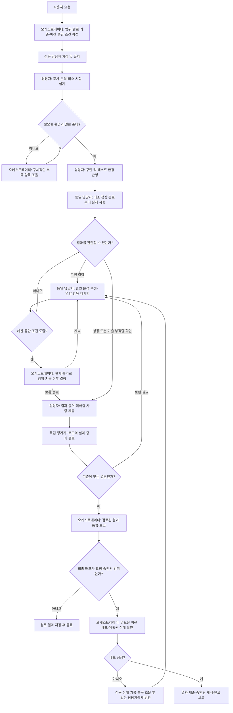

# 담당자 책임형 작업 파이프라인

이 문서는 `shared/workflows/owner-led-delivery.md` 1.0.0의 한국어 안내입니다. `AGENTS.md`가 메인 세션과 모든 위임 역할에 공유 워크플로우를 읽고 따르도록 연결합니다. 호스트 권한을 강제하는 실행 코드나 자동 실행 엔진을 새로 만든 것은 아닙니다.

## 역할과 책임

| 담당 | 책임 |
|---|---|
| 오케스트레이터 | 목적·범위·완료 기준·작업 예산·담당자 지정, 필요한 권한·외부 결정 조율, 검토된 결과 통합과 승인된 최종 배포 |
| 동일 전문 담당자 | 분석, 구현, 테스트 환경 반영, 실제 시험, 실패 원인 분석, 수정과 영향 범위 재시험 |
| 독립 평가자 | 정확한 후보 버전과 실제 시험 증거 검토, 필요한 항목만 독립 재현, 결함을 같은 담당자에게 반환 |
| 사용자 | 필요한 요구사항·외부 결정 제공, 기존 승인에 포함되지 않은 도입·배포 결정 |

인프라 도입 R&D는 인프라 담당자가 PoC와 환경 시험을 책임지고, OSS R&D 담당자가 공식 자료·대안·라이선스 조사 등의 한정된 부분을 맡을 수 있습니다. 버그가 생길 때마다 담당자를 바꾸지 않습니다.

## 전체 흐름

문서·정책·설정 변경에는 해당하는 검증만 적용합니다. 실제 실행이나 배포가 없는 작업에 VM 시험을 억지로 추가하지 않습니다.

## 검토에 넘기는 시점

담당자가 후보 버전·해시, 환경·버전, 실제 실행 절차와 결과, 완료 기준별 상태, 반복 실행 횟수와 이유, 미실행 항목, 남은 제약을 준비한 뒤 최종 독립 검토를 요청합니다.

코드 검토나 모의 시험만 했다면 준비 상태만 판단할 수 있습니다. 실제 배포·격리 성공을 주장하려면 해당 환경의 실행 증거가 필요합니다. 평가자는 모든 시험을 다시 돌리지 않고, 중요한 주장 중 확인이 부족한 부분만 재현합니다. 기존 필수 검사 규칙은 유지합니다.

## 실패와 반복 관리

- 최소 정상 경로를 일찍 시험해 환경 가정의 오류를 먼저 찾습니다.
- 실패하면 같은 담당자가 진단과 수정, 영향받은 부분의 재시험까지 맡습니다.
- 수정하지 않은 부분의 증거는 유효한 조건이 유지되면 재사용합니다. 반복 실행을 새로운 검증 항목으로 합산하지 않습니다.
- 작업별 예산·점검 시점·중단 조건을 미리 정합니다. 근거 없는 반복이나 예산 초과는 범위·계속 여부를 조율할 사유입니다.
- 도입 R&D에서는 기술이 부적합하다는 결과도 유효합니다. 통과할 때까지 조건을 약화하지 않습니다.
- 설명·상태 질문에는 먼저 답합니다. 설명만 요청했는데 새 디버깅을 시작하거나, 중단 요청을 강제 완료 요청으로 해석하지 않습니다.

## 재위임과 권한

서브에이전트의 추가 위임은 부모의 명시적인 범위 지정이 있을 때만 가능합니다. 평가자는 자신의 평가를 재위임하지 않습니다. 추가 전문가가 참여해도 원래 담당자의 시험·수정 책임은 유지됩니다. 실제 동시 실행 한도와 접근 권한은 호스트가 결정합니다.

테스트 VM에 후보를 반영하는 작업은 담당자의 시험 과정입니다. 오케스트레이터가 수행하는 최종 배포와 구분합니다. 기존 승인 범위를 재사용하되, 도입 검토 요청만으로 운영 배포까지 승인됐다고 보지 않습니다.

## 이번 설정 변경의 적용 범위

공통 진입 지침과 공유 워크플로우를 연결했습니다. 역할의 ID·버전·도구 권한·결과 스키마는 변경하지 않았고 기존 작업 스냅샷도 수정하지 않았습니다. P2의 중단된 VM 디버깅이나 배포를 재개하지 않습니다. 이번 확인은 지침 연결·호환성·시나리오 검토이며, 모든 향후 에이전트가 항상 올바르게 행동한다는 보증이나 실제 운영 배포 성공을 의미하지 않습니다.
